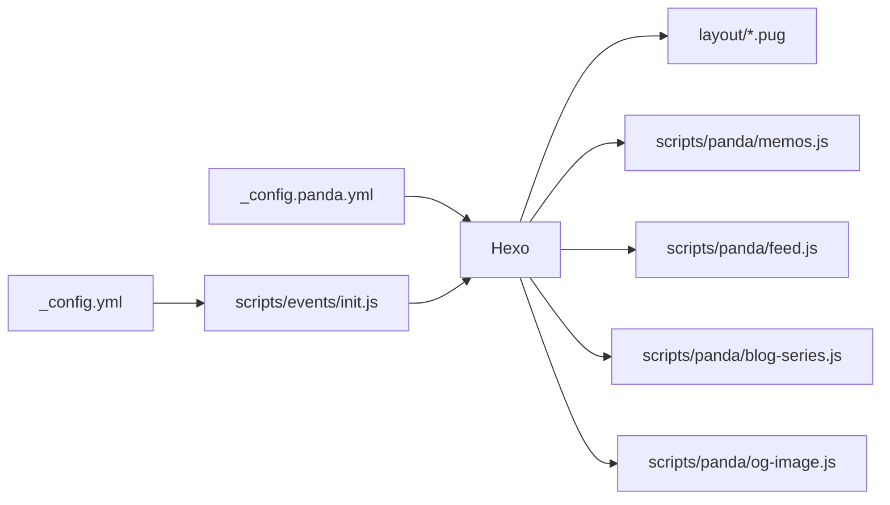

<div align="right"><a title="中文" href="README_CN.md">中文</a> | English</div>

<p align="center">
  
</p>

<h1 align="center">hexo-theme-panda</h1>

<p align="center">
  <a href="LICENSE"></a>
  <a href="https://www.npmjs.com/package/hexo-theme-panda"></a>
  <a href="https://www.npmjs.com/package/hexo-theme-panda"></a>
  <a href="https://hexo.io"></a>
  <a href="https://nodejs.org"></a>
  <a href="https://speechlesspanda.github.io"></a>
</p>

<p align="center">A card-style Hexo theme: memos timeline, blog series, gradient visuals, built-in Atom feed &amp; OG image generation</p>
<p align="center">Forked and extended from <a href="https://github.com/jerryc127/hexo-theme-butterfly">hexo-theme-butterfly</a> 5.7.0 (Apache-2.0)</p>
<p align="center"><strong>Demo</strong>: <a href="https://speechlesspanda.github.io">SpeechlessPanda's Blog</a> · <strong>npm</strong>: <a href="https://www.npmjs.com/package/hexo-theme-panda">hexo-theme-panda</a></p>

---

## ✨ What Panda adds on top of Butterfly

| Feature | Description | Default |
|---------|-------------|---------|
| Memos enhancements | Per-memo Giscus comment iframes, auto-expand commented memos, standalone deep-link pages, local-search injection | on |
| Home-as-about | Home renders `about/index.md`; the post stream moves to `/blog/` | on (optional) |
| Latest memo card | The newest memo pinned on top of the post stream | on |
| Blog series | A `_posts/<name>/` folder with `index.md` becomes one card on the post stream; chapters stay off the stream | on |
| Atom feed | Custom generator mixing posts + memos, with update-notification entries | on |
| OG share images | Per-post 1200×630 gradient images (requires `@resvg/resvg-js`) | off |
| Gradient look | Blue→purple→orange gradient header/footer/background (configurable, yields to your images) | on |
| Nav background band | With an image `background`, the fixed nav paints that image's top band, viewport-locked and aligned with `#web_bg` | on |
| Link target blank | Article/memo links open in a new tab | on |
| Extra highlighting | fish & typst grammars registered out of the box | built-in |
| `` collapse | Expanded blocks get a bottom collapse bar that scrolls back to the header | on |
| Heading anchors | Stable heading IDs, reachable permalinks and copyable links | on |
| AI-readable & discovery | `robots.txt`, `sitemap.xml`, `llms.txt`, Markdown mirrors, `/ai/`, `/rights/` and `hexo panda verify-ai` | on |


Panda keeps Butterfly's configuration for the features it inherits, including PJAX, dark mode, comments, search and word count.

## 📦 Installation

### npm (recommended)

Hexo **≥ 5.3.0**. Run this in the Hexo **site** root (not inside the theme). Package: [hexo-theme-panda](https://www.npmjs.com/package/hexo-theme-panda).

```bash
npm install hexo-theme-panda
```

The npm package installs the runtime libraries and Pug/Stylus renderers. Hexo 8 loads the renderers from the theme package. Older loaders such as Hexo 5.3 require `npm install hexo-renderer-pug hexo-renderer-stylus` in the site root.

> **`themes/` wins over `node_modules`.** Hexo looks for `themes/<theme>` *first* and only falls back to `node_modules/hexo-theme-<theme>`. If you previously cloned the theme, **delete `themes/panda/`** — otherwise the stale copy keeps loading and `npm update hexo-theme-panda` silently does nothing. The build prints a warning when this happens.

Upgrading an existing install: see [🔄 Upgrading](#-upgrading).

### Git clone

Only if you want to hack on the theme itself.

```bash
git clone https://github.com/SpeechlessPanda/hexo-theme-panda.git themes/panda
npm --prefix themes/panda install
```

Enable the theme in the site `_config.yml`:

```yaml
theme: panda
```

New site from scratch:

```bash
npm install -g hexo-cli
hexo init my-blog && cd my-blog
npm install hexo-theme-panda
```

Then set `theme: panda` as above.

## 🔄 Upgrading

Two commands, and both of them matter:

```bash
npm update hexo-theme-panda
hexo clean && hexo generate
```

- **`npm update` only swaps files in `node_modules`.** It rebuilds nothing, so a `public/` written by the previous theme keeps rendering exactly what it had — including the old version in the footer.
- **`hexo clean` before `hexo generate`.** An upgrade can drop or rename files under `source/`; `hexo clean` deletes `public/` and `db.json` so nothing from the old theme survives. Running `hexo generate` alone after a theme upgrade is the usual cause of a site that looks half-updated.

Swap in `pnpm update` / `yarn upgrade` if that is your package manager.

If `npm update` says **Already up to date** while a newer release exists on [npm](https://www.npmjs.com/package/hexo-theme-panda), you are resolving through a registry mirror that has not caught up yet. Pin the version to get past it: `npm install hexo-theme-panda@latest` (`pnpm add` / `yarn up` behave the same way).

### If a CI or a host builds your site

GitHub Actions, Vercel, Netlify, Cloudflare Pages and friends build from **the committed lockfile**, not from your laptop. After the two commands above, commit the result and push:

```bash
git add package.json package-lock.json   # or pnpm-lock.yaml / yarn.lock
git commit -m "chore(deps): bump Panda theme"
git push
```

Skipping this is the single most common "I upgraded but the footer still shows the old version" report: your local `public/` runs the new theme, while the deployed site keeps rendering whatever the lockfile in the repository still pins. The build now prints the version it used, so the CI log tells you which theme produced the deployment.

### Verify

| Where | What you should see |
|-------|---------------------|
| `hexo g` output | `[panda] theme X.Y.Z · Hexo A.B.C · N files generated` (plus the banner at startup) |
| CI log | the same `[panda] theme X.Y.Z` line on the run that deployed |
| Any page footer | `Panda X.Y.Z` next to the Hexo version |
| Page source | theme assets carrying `?v=X.Y.Z` |

If the `[panda]` line, the footer and the `?v=` disagree, the page you are reading was not built by the theme you have installed — regenerate, then redeploy.

## 🖥️ Daily commands

All of these run in the **site root**. Full CLI: [Hexo commands](https://hexo.io/docs/commands).

| Command | What it does |
|---------|----------------|
| `hexo new "My post"` | New article → `source/_posts/My-post.md` |
| `hexo new series "Intro to X"` | New series → `source/_posts/Intro to X/index.md` (title is the folder name, not slugized) |
| `hexo new --series "Intro to X" "Chapter 1"` | New chapter → `source/_posts/Intro to X/Chapter 1.md` (creates `index.md` if missing) |
| `hexo new page about` | New page → `source/about/index.md` |
| `hexo server` / `hexo s` | Local preview at http://localhost:4000/ |
| `hexo s --draft` | Preview including drafts |
| `hexo generate` / `hexo g` | Build static files into `public/` |
| `hexo deploy` / `hexo d` | Publish `public/` with your deployer |
| `hexo g -d` | Generate, then deploy |
| `hexo clean` | Delete `db.json` and `public/` |
| `hexo clean && hexo g -d` | Full republish |
| `hexo clean && hexo s` | Stale theme/config? wipe cache, then preview |

Memos (碎碎念) are **not** created with `hexo new`. Edit `source/_data/shuoshuo.yml`, then `hexo s` or `hexo g`.

### Deploy (publish the blog)

`hexo deploy` needs a deployer plugin. GitHub Pages example:

```bash
npm install hexo-deployer-git
```

```yaml
# site _config.yml
deploy:
  type: git
  repo: git@github.com:<user>/<user>.github.io.git
  branch: main
```

```bash
hexo clean && hexo g -d
```

Panda writes `public/atom.xml` itself. Do **not** also enable `hexo-generator-feed` (both would claim the same path).

## ⚙️ Configuration

Same convention as Butterfly: **don't edit** the packaged `_config.yml` (`node_modules/hexo-theme-panda/_config.yml` or `themes/panda/_config.yml`). Create `_config.panda.yml` in your site root and put your overrides there (Hexo deep-merges, overlay wins).

The fully-commented default config lives in [_config.yml](_config.yml).



## ✅ Requirements

- [Hexo](https://hexo.io/) **≥ 5.3.0** (8.x works; this is what the demo runs). 5.3.0 and 8.x are both covered by the build tests and by CI.
- Node.js **≥ 22**
- Use a Hexo Markdown renderer in the site. Panda's layouts and CSS use `hexo-renderer-pug` and `hexo-renderer-stylus`; declare them in the site when its Hexo version does not load theme dependencies.

Optional extras, only if you turn the matching feature on:

| Feature | Extra install |
|---------|----------------|
| OG share images (`og_image.enable`) | `npm install @resvg/resvg-js` |
| Local search injection | Butterfly-style `search.use: local_search` plus a search data file |
| Memo comment counts | `GH_DISCUSSION_TOKEN` in the build environment |

## 🐼 Panda features

### Home-as-about

```yaml
# _config.panda.yml
home_about:
  enable: true            # use the standalone home page's own content if the about source is missing
  source: about/index.md
```

Move the post stream to `/blog/` and bind the home page:

```yaml
# site _config.yml
index_generator:
  path: /blog
```

```markdown
---
title: About
layout: home
---
```

(source/index.md)

`/` keeps the full-screen hero (title + typewriter). `/blog/` uses the same short header as About / Links (`#page-site-info`, i18n `page.articles`), not the homepage banner.


### Memos (shuoshuo)

1. Create `source/memos/index.md`:

```markdown
---
title: Memos
type: shuoshuo
---
```

2. Write entries in `source/_data/shuoshuo.yml`:

```yaml
- date: 2026-09-10 12:00   # site timezone (_config.yml `timezone`)
  content: Supports **markdown** and [links](https://example.com)
  tags: [life]              # optional
  key: my-custom-key        # optional; derived from date otherwise
```

```yaml
# _config.panda.yml
memos:
  enable: true
  path: /memos/            # page path (shared by card link, standalone pages, feed)
  data_key: shuoshuo       # source/_data/<data_key>.yml
  latest_card: true        # "latest memo" card on the post stream
  standalone_pages: true   # one deep-linkable page per memo
  search_injection: true   # inject into local search (needs search.use: local_search)
  comment_count: true      # build-time Giscus activity (comment or emoji reaction) -> auto-expand
```

Without authored data, the timeline is empty and no memo card, standalone memo page or feed entry is published.

Comments use Giscus (`comments.use: Giscus` + `giscus.*`, same as Butterfly). Each memo gets its own discussion via the theme's multi-iframe giscus `/widget` integration.

> `comment_count` needs `GH_DISCUSSION_TOKEN` (a GitHub token with discussions read access) in the build environment. Without it, the step is skipped silently and comment areas stay collapsed.

### Blog series

A series is a **one-level folder** under `source/_posts`, not Butterfly's `` tag (`series.enable` stays off).

| Path | Role |
|---|---|
| `source/_posts/hello.md` | Independent post, shown on the post stream |
| `source/_posts/Intro to X/index.md` | Series metadata only (`title` + `description` keys required; `description` may be empty). Not a post, not in the feed |
| `source/_posts/Intro to X/Chapter 1.md` | Chapter: listed on the series page, hidden from the post stream, still an RSS entry |

`index.md` example:

```markdown
---
title: Intro to X
description: From zero to a working setup
cover: /img/series-intro.jpg
---
```

`cover` is the series thumbnail (same idea as a post `cover`). It appears on the `/blog/` series card and as the series page header. It does **not** inherit from chapters.

| `cover` value | Effect |
|---|---|
| `/img/foo.jpg`, `https://…/foo.png` | Image. Local files go in `source/` so the URL matches (`source/img/foo.jpg` → `/img/foo.jpg`). Also `gif` / `svg` / `webp` / `avif` |
| `linear-gradient(135deg, #6ec6ff, #ffd2a8)` or `#6ec6ff` | CSS background, not an `` |
| empty / omit / `false` | No card image; series page header falls back to `default_top_img` |


The post stream mixes independent posts and series cards, newest first. A series card's date is its **latest chapter**. Empty series (index only) are omitted. Drag existing posts into the folder — no extra front-matter — and they leave the stream on the next `hexo g` / `hexo s`. CLI: `hexo new series "Intro to X"` and `hexo new --series "Intro to X" "Chapter 1"` (see [Daily commands](#-daily-commands)).

```yaml
# _config.panda.yml
blog_series:
  enable: true
  path: /series/    # landing page URL prefix
```

Landing pages: `/series/<folder>/`. Chapter permalinks stay whatever your site `permalink` already is. In-series prev/next only walks sibling chapters. Comments on the series page follow the site comment system; set `comments: false` on `index.md` to turn them off.

Deeper than one folder (`_posts/a/b/c.md`) is ignored.

### Atom feed

```yaml
# _config.panda.yml
feed:
  enable: true           # on by default; do not run hexo-generator-feed together
  path: atom.xml
  post_limit: 20
  excerpt_limit: 140
  update_notify_hours: 24  # re-push posts with explicit front-matter `updated:` >24h after `date:`
  include_memos: true
```

Entry identity lives entirely in the URL path (never query/fragment), which every reader preserves; memo entries link to their standalone pages and update entries to auto-generated redirect stubs. Entry ids derive from file **content**, never from file mtime (which is just checkout time on CI): rebuilding after any unrelated change — e.g. adding a memo — never re-pushes old posts. New posts scaffold with `updated: false` and `sticky: false`; to re-push a revised post, flip `updated` to a real date (`updated: 2026-09-28 21:00:00`) more than `update_notify_hours` after `date:` — `false`/`null`/`~`/empty all mean "never revised" and are ignored. Values are unquoted before that check, so the quoted spellings (`updated: "false"`, `updated: ""`) mean the same as their bare forms. Key detection accepts any spacing YAML allows, so an existing `sticky : true` (space before the colon) is recognised and never duplicated. The stub id is a content hash, so every further edit notifies exactly once more, and ids stop moving the moment you stop editing. Series chapters are ordinary posts: they scaffold the same keys and re-push the same way. Memo dates accept `YYYY-MM-DD HH:mm` (also ISO `T` or date-only); a memo with an unparseable date is skipped with a build warning. Series `index.md` is not a post and never appears in the feed. A series card on the post stream is dated by its latest chapter, so a new chapter also moves the card.

### OG share images

```bash
npm install @resvg/resvg-js   # once, in your site
```

```yaml
# _config.panda.yml
og_image:
  enable: true
  width: 1200
  height: 630
```

The LXGW WenKai font (SIL OFL 1.1) is downloaded once into `fonts/` on first build. Each post gets `og-images/<slug>.png` wired into `og:image`.

### Gradient look

On by default. Setting Butterfly's `background`, `default_top_img` or `footer_img` makes the matching gradient area yield to your image automatically. To recolor:

```yaml
# _config.panda.yml
gradient:
  header_light: linear-gradient(135deg, ...)
  header_dark: linear-gradient(135deg, ...)
  web_bg_light: linear-gradient(180deg, ...)
  web_bg_dark: linear-gradient(180deg, ...)
  # plus header_mask_* / nav_* — see the default config comments
```

Disable entirely: `gradient.enable: false`.

### Website background & nav band

Butterfly's `background` paints the page background (`#web_bg`). Panda adds one thing on top: when that value is an **image**, the fixed nav bar paints the **top band of the same image**, locked to the viewport. It no longer scrolls away, and it no longer falls back to a flat gradient bar.

```yaml
# _config.panda.yml
background: /img/bg.webp        # an array works too — a random pick on each load
```

Why it lines up: `#web_bg` is a viewport-sized box with `background-size: cover` + `background-position: center`. Painting that same `cover` onto the 60px `#nav` box zooms into the photo's middle. The scrolled bar instead uses a viewport-sized `#nav::before` (`100vw×100vh`, `cover`, `center`, clipped to 60px) so it shows the top strip of the rendered page background — same pixels, no seam, no scroll.

Legibility: the band carries a scrim (`gradient.nav_band_mask_light/dark`) under white / `#eaf4ff` nav text. Measured against a mid-tone photo: 5.0:1 in light mode, 5.2:1 in dark mode. Unusually light or dark image? Retune:

```yaml
# _config.panda.yml
nav:
  background_band: true      # false keeps the gradient nav bar
  band_text_light: '#ffffff'
  band_text_dark: '#eaf4ff'
gradient:
  nav_band_mask_light: 'linear-gradient(180deg, rgba(12, 24, 44, 0.6) 0%, rgba(12, 24, 44, 0.42) 100%)'
  nav_band_mask_dark: 'linear-gradient(180deg, rgba(0, 0, 0, 0.58) 0%, rgba(0, 0, 0, 0.42) 100%)'
```

Edge cases:

- A color or a raw CSS gradient in `background` has no "top band", so the nav keeps the normal gradient bar.
- A random-array `background` keeps the nav on the image `#web_bg` actually picked (synced at runtime, PJAX included).
- iOS Safari still mishandles a viewport-locked image in the 60px bar. There the theme drops the image layer and keeps the scrim + blur.

### Heading anchors

The build (`after_post_render`) adds an `id` and an `a.headerlink` permalink to every `h1-h6` in posts and pages:

- Existing ids win (published deep links keep working); duplicates get `-2`/`-3` in document order; missing ones are slugized from the heading text with CJK preserved and fall back to `section-N`. Markdown renderers assign ids per render call, so the same heading inside a ``/`` block and in the body used to collide — this pass fixes that once for the whole document.
- The renderer's empty `<a class="markdownIt-Anchor"></a>` placeholder is dropped (0×0, invisible, and it leaked a leading space into TOC text); a renderer anchor with a visible custom symbol is kept and pointed at the final `id`.
- No-JS works: a plain `<a href="#id">` plus CSS `scroll-margin-top` puts the target below the fixed nav. `source/js/anchor.js` only covers what the browser cannot: a target inside a closed `<details>`, an unopened hide-block/hide-inline or an inactive tab is revealed first, and layout drift from webfonts/lazy images is re-aligned within a 1.2s window that stops as soon as the reader touches anything.
- Clicking `#` copies the full absolute URL; links whose `href` is not a pure fragment are left alone.

```yaml
# _config.panda.yml
anchor:
  enable: true           # ids + `#` permalinks (default on)
  copy_link: true        # clicking `#` copies the full URL (default on)
  click_to_scroll: false # clicking anywhere on a heading acts like `#` (default off: it breaks text selection)
  auto_update: false     # keep the URL in sync with the heading in view
```

**Verification**: `node --test test/*.test.js` includes the `heading-anchor.test.js` unit tests; `node test/_smoke_anchor.js` builds a real throwaway site and asserts the generated HTML/CSS/JS (unique heading ids, every permalink resolves, no dead TOC links, CJK label, `?v=` cache-bust).

### AI-readable & content discovery

Discovery and AI-readable outputs have been on by default since 1.2.0. `hexo generate` derives them locally from the site's content; no AI API is called.

```yaml
# _config.panda.yml
site_discovery:
  enable: true
  robots:
    provider: panda      # panda | external | disabled
    policy: balanced     # balanced | permissive | custom
    allow: []            # paths allowed site-wide (repeated in every allowed group)
    disallow: []         # paths disallowed site-wide, e.g. ['/memos/']
    custom_groups: []    # [{ user_agents: [SomeBot], allow: [], disallow: [], content_usage: ['train-ai=n'], note: ... }]
    sitemap: true        # emit the absolute `Sitemap:` line
    usage_ai_training: deny   # deny | allow | omit
    google_agent: omit        # omit | allow | disallow (robots does not govern it)
  sitemap:
    provider: panda      # panda | external | disabled
    include_tags: true
    include_categories: true
    include_pages: true
    exclude_noindex: true     # external mode only; built-in mode always drops noindex
    exclude: []               # globs relative to source/

ai_readable:
  enable: true           # master switch for everything below
  intro: null            # one sentence for llms.txt (null = site description)
  author_bio: null       # null = derived from config.author
  topics: [hexo, linux]  # plain strings, or [{ name, description }] / a data file
  llms_txt:
    enable: true
    path: llms.txt
    recent_posts: 10     # 0 = no article list
    series: true         # one entry per series, chapters nested
    topics: true         # H2 "Topics" section from curated topics
    license: true        # H2 "Licensing and AI usage" section
    resources: true      # sitemap / feed / archive / portal / rights links
    sections: []         # extra H2 sections
  markdown:
    enable: true
    include_posts: true
    include_series: true
    include_pages: false
    path_style: index    # index -> /post/index.md, suffix -> /post/index.html.md
    exclude: []          # globs, e.g. ['_posts/draft/**']
  portal:
    enable: true
    path: /ai/
    respect_existing_pages: true   # a page you wrote there wins
    projects: []         # [{ name, url, description, order }]
    featured_posts: []   # [{ source: _posts/foo.md }] or plain source strings
    social_icon:
      enable: true
      show_in_author_card: true   # the robot sits after the icons, under Follow Me
      icon: fas fa-robot
      label: null        # null = localized default
      color: null        # null = same colour as the other social icons
  rights:
    enable: true
    path: /rights/
    respect_existing_pages: true   # same rule as the portal
    license: inherit     # inherit = theme.post_copyright
    license_url: inherit
    contact: null
    ai_training: deny    # deny | allow | omit — a preference, not a license
    ai_use: allow-search
    extra: null          # extra Markdown appended to the page
```

| Output | Default | What you get |
|--------|---------|--------------|
| `robots.txt` | `panda` | The balanced policy distinguishes search, user-triggered fetches and training crawlers. `robots.disallow` is a request to compliant crawlers, not access control. Explicit custom groups replace the balanced policy in `policy: custom`. A source `robots.txt` takes precedence. |
| `sitemap.xml` | `panda` | Absolute URLs derived from the site's `url`; dates come from content, not the build clock. A source `sitemap.xml` takes precedence. In `external` mode the theme marks exclusions for the external generator when `exclude_noindex` is enabled. |
| `llms.txt` | on with `ai_readable` | v2 structure: H1, blockquote summary, background, H2 sections (Featured / Articles / Series / Projects / Topics / Licensing / Resources). A series lists its chapters nested underneath instead of repeating them as top-level links, and links point at the Markdown mirror whenever one exists |
| Markdown mirrors | on | `index.md` beside every post and series chapter, converted from the raw Markdown source, plus `<link rel="alternate" type="text/markdown">` and `<link rel="describedby">` in `<head>` |
| `/ai/` | on | Human-facing reading guide: intro, topics, featured/recent posts, series, projects, and links to llms.txt / sitemap / feed / rights |
| `/rights/` | on | Copyright, license, commercial use, AI usage preference and contact — reusing `post_copyright` |

**Curating from `source/_data/ai.yml`.** Everything above also reads an optional data
file, so your personal curation stays in your blog repo and the theme default stays
empty:

```yaml
# source/_data/ai.yml
site:
  tagline: One line shown as the llms.txt blockquote
  description: The longer "about this site" paragraph
  organization: How content is organised (articles / series / memos)
about:
  name: Your name
  description: Your public bio
  contact: mailto:you@example.com
topics:                     # tag name → what that tag is about
  - { name: hexo, description: Static-site notes }
featured:                   # wins over ai_readable.portal.featured_posts
  - { source: _posts/hello.md, summary: Why this one matters }
projects:                   # wins over ai_readable.portal.projects
  - { name: my-theme, url: https://github.com/you/it, description: ... }
latest_count: 5
```

The file merges over the config: text fields fall back to config, while non-empty
`topics`/`featured`/`projects` lists replace the config lists (a curated list is an
editorial decision, so appending would double-link posts). A `source:` that matches no
published post logs a warning instead of silently vanishing; chapters of a series can
be featured too.

**Your own pages win.** A page you wrote at `ai_readable.portal.path` or
`ai_readable.rights.path` is your content, so the theme leaves it untouched and logs
which file it stepped aside for. The sitemap still lists it. Set
`respect_existing_pages: false` to force the generated page instead, which then aborts
the build if a page still claims the path.

**Duplicate generators abort the build.** Choosing `provider: panda` while another plugin already claimed `robots.txt` or `sitemap.xml` stops the build with the offending generator's name instead of letting two plugins fight over one path.

**Front-matter opt-outs**

```yaml
noindex: true        # page-level noindex plus exclusion from sitemap, llms.txt, mirrors and portal
robots: noindex      # same, in the spelling some sites already use
sitemap: false       # out of sitemap.xml only
ai_readable: false   # out of llms.txt, mirrors and portal; stays in the sitemap
markdown: false      # no Markdown mirror only
```

**AI reading icon.** The author card displays the robot after the other social icons, below Follow Me. If you hide the author card or sidebar on a page, the icon is not displayed.

**Verify a build**

```bash
hexo generate
hexo panda verify-ai
```

The command reads the generated `public/` directory (what a deploy actually ships) and checks nine things: robots groups and the absolute Sitemap URL; llms.txt structure and that every mirror link resolves; sitemap URLs that all correspond to generated pages and contain no excluded content; mirror coverage with no front matter, HTML or Hexo tag left inside; `alternate`/`describedby` correctness; the portal and rights pages; the home icon's position, order, `aria-label` and `title`; and that no excluded source path leaked into any output. It exits non-zero on failure, so it drops into CI:

```yaml
# .github/workflows/deploy.yml
- run: npm ci
- run: hexo clean && hexo generate
- run: npx hexo panda verify-ai
```

#### FAQ

**I already run a sitemap/robots plugin — will upgrading break my build?** No. `panda` became the default in 1.2.0, and when the theme detects a plugin already writing that file it steps aside, leaves the plugin in charge and logs one warning. Set `provider: external` to silence the warning, or `panda` (explicitly) to make the theme own the file — an explicit `panda` next to a conflicting plugin is a build error naming the plugin.

**`hexo panda verify-ai` says a mirror is missing.** A page advertises `rel="alternate"` for a mirror that was not generated. Usual causes: the post is `noindex`, matches `markdown.exclude`, or `markdown.enable` was turned off after a previous build. Run `hexo clean` first; the head link and the file are produced in the same pass, so they can only disagree across stale builds.

**Why is /ai/ showing an English section title?** Section headings come from the language files. If you use a locale Panda does not ship, add `ai_readable.llms.heading_*` overrides or they fall back to English.

**Where is the robot icon?** In the author card's social row. Set `ai_readable.portal.social_icon.show_in_author_card: false` to hide it.

**Does the theme block AI crawlers by itself?** No. `robots.txt` is only produced with `robots.provider: panda` (the default), and even then it records a *preference*. Training crawlers that ignore robots.txt still read the site; use authentication or a CDN/WAF for enforcement.

**Will llms.txt grow without bound?** No. `llms_txt.recent_posts` caps the article list, series are one entry each, and there is no archive dump. Raise the number if you want a longer index.

**Does the build call an AI service?** Never. Everything is derived from Hexo's models and your source Markdown; summaries fall back to titles, descriptions and front matter.

**Can I exclude one post?** `noindex: true` excludes it from indexing and discovery outputs, not from public access. Use `sitemap: false` to omit only the sitemap entry, `ai_readable: false` to omit AI discovery, or `markdown: false` to omit only its mirror.

**Known limits.** `robots.txt` is a crawling preference, not access control or privacy: it cannot stop a determined crawler. `Google-Extended` is a product control token — it affects Gemini training and grounding, never Google Search inclusion or ranking. `ChatGPT-User` and `Google-Agent` are user-triggered, so their access is governed by your CDN/WAF, not by robots rules. The AI-usage preference on `/rights/` is a statement of intent, separate from the license: CC BY-NC-SA 4.0 does not by itself settle training authorization. Only public, published, non-`noindex` content is indexed; drafts never are.

### Misc

```yaml
# _config.panda.yml
link_target_blank: true   # article/memo links open in a new tab (default on)
```

Visitor counts (Busuanzi) and legacy vendor prefixes are opt-in. To restore them, set the relevant `busuanzi.site_uv`, `busuanzi.site_pv` or `busuanzi.page_pv` flags to `true`, or set `css_prefix: true` in `_config.panda.yml`. To restore JSON-LD on supported pages, set `structured_data.enable: true`.

fish / typst code highlighting works out of the box.

`…` is Butterfly's tag. Panda adds a bottom collapse bar (i18n: en Collapse / zh-CN 收起 / zh-TW 收合 / ja 閉じる / ko 접기). Clicking it closes the block and scrolls back to the header under the fixed nav. Asset URLs carry `?v=<theme version>` so a patch like 1.1.1 busts cached `main.js` / `index.css`.

## ⬆️ Upgrading 1.1.10 → 1.2.0 (AI surfaces on by default)

1.2.0 turns the seven AI-readable surfaces **on** and writes them from your existing posts and config, so a site that upgrades gets them without editing a single key. Nothing you already configured changes meaning; the only behaviour change is that files you may not have had before now exist.

**About sitemap and robots plugins.** `panda` is now the default provider. If a plugin already writes `sitemap.xml` or `robots.txt`, the theme notices it, leaves the file to the plugin and logs one warning with the plugin's name — an upgrade never fails a build. Warnings look like:

```
[panda] sitemap.xml: the plugin (sitemap) keeps writing this file; the theme steps aside.
        Remove the plugin, or set site_discovery.sitemap.provider to "external" to silence
        this, or to "panda" to make the theme own it.
```

| You currently use | What 1.2.0 does | To let Panda own the file |
|---|---|---|
| `hexo-generator-sitemap` | plugin keeps `sitemap.xml`, theme warns once | uninstall it, then set `provider: panda` explicitly (a conflict next to an explicit `panda` is a hard error) |
| `hexo-generator-robotstxt` | plugin keeps `robots.txt`, theme warns once | same as above |
| `hexo-generator-baidu-sitemap` | untouched, keeps `baidusitemap.xml` | — |
| nothing | theme writes both plus llms.txt, mirrors, `/ai/`, `/rights/` | already done |

**The AI reading entry** is the robot icon at the end of the author card's social row, directly under the Follow Me button. It shows up automatically; `portal.social_icon.show_in_author_card: false` hides it, `portal.social_icon.icon` / `.color` / `.label` restyle it.

**Turning it back off** (the 1.1.10 footprint):

```yaml
site_discovery:
  robots: { provider: disabled }
  sitemap: { provider: disabled }
ai_readable:
  enable: false
```

**Everything stays editable.** `/ai/` and `/rights/` step aside when you already wrote a page at those paths, `source/_data/ai.yml` overrides the curated text (intro, topics, featured posts, projects), and `llms_txt.sections` / `portal.projects` add your own entries. Nothing is hard-coded to one blog.

**Do the files update themselves?** Yes — every surface is regenerated from Hexo's models on each `hexo generate`, so a new or edited post updates llms.txt, its Markdown mirror, sitemap `lastmod`, the portal listing and the `<head>` alternate link in the same run. `hexo server` re-reads them on every rebuild too. There is no cache to clear and no manual step; the only stale case is a deploy that skips `hexo generate`.

**Wiring verification into GitHub Actions**

```yaml
- run: npm ci
- run: hexo clean && hexo generate
- run: npx hexo panda verify-ai
```

**Recommended config for a personal blog**

```yaml
# _config.panda.yml
site_discovery:
  robots:
    provider: panda
    policy: balanced
  sitemap:
    provider: panda
    include_tags: false       # tag pages add little for search engines
    include_categories: true

ai_readable:
  enable: true
  intro: 一个写 Hexo、Linux 和工程实践的个人博客   # replace with your own sentence
  topics: [hexo, linux, rust]
  llms_txt:
    recent_posts: 15
  portal:
    path: /ai/
    projects:
      - name: hexo-theme-panda
        url: https://github.com/SpeechlessPanda/hexo-theme-panda
        description: 本博客使用的主题
    featured_posts:
      - source: _posts/开始写博客.md
  rights:
    ai_training: deny
    contact: mailto:you@example.com
```

## 🔄 Migrating from Butterfly

1. Replace `themes/butterfly` with this theme (or swap the npm package) and set `theme: panda`
2. Rename `_config.butterfly.yml` to `_config.panda.yml`
3. Butterfly's legacy `_data/butterfly.yml` override is not supported (Panda warns on startup)
4. Every other config key is compatible

## 📄 License

[Apache-2.0](LICENSE). Panda is derived from [hexo-theme-butterfly](https://github.com/jerryc127/hexo-theme-butterfly) by Jerry (Apache-2.0); see [NOTICE](NOTICE) for attribution and the list of changes. Modified files carry a notice in their header comments. The OG font [LXGW WenKai](https://github.com/lxgw/LxgwWenKai) is SIL OFL 1.1.

Releases: [CHANGELOG.md](CHANGELOG.md).
