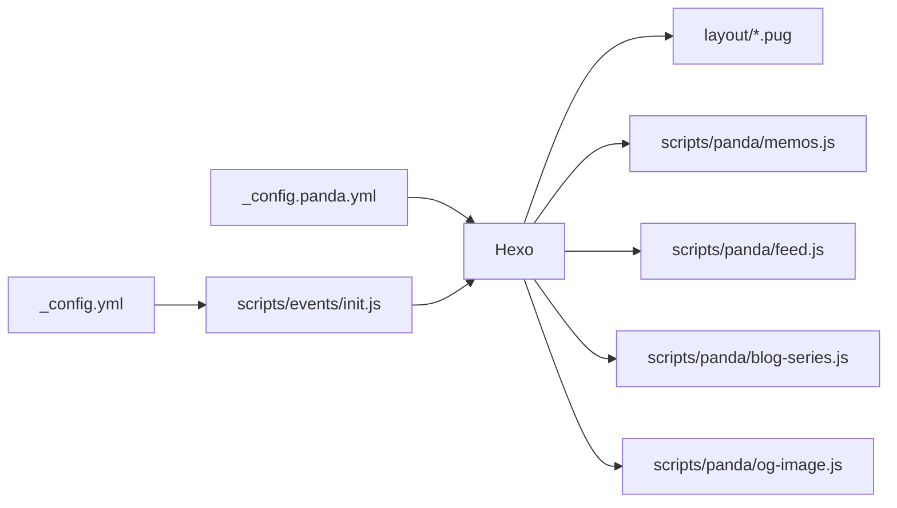

<div align="right">中文 | <a title="English" href="README.md">English</a></div>

<p align="center">
  
</p>

<h1 align="center">hexo-theme-panda</h1>

<p align="center">
  <a href="LICENSE"></a>
  <a href="https://www.npmjs.com/package/hexo-theme-panda"></a>
  <a href="https://www.npmjs.com/package/hexo-theme-panda"></a>
  <a href="https://hexo.io"></a>
  <a href="https://nodejs.org"></a>
  <a href="https://speechlesspanda.github.io"></a>
</p>

<p align="center">卡片式 Hexo 主题：碎碎念时间线、博客系列、渐变视觉、内置 Atom feed 与 OG 图生成</p>
<p align="center">基于 <a href="https://github.com/jerryc127/hexo-theme-butterfly">hexo-theme-butterfly</a> 5.7.0 二次开发（Apache-2.0）</p>
<p align="center"><strong>演示站点</strong>: <a href="https://speechlesspanda.github.io">SpeechlessPanda's Blog</a> · <strong>npm</strong>: <a href="https://www.npmjs.com/package/hexo-theme-panda">hexo-theme-panda</a></p>

---

## ✨ Panda 在 Butterfly 之上新增了什么

| 特性 | 说明 | 默认 |
|------|------|------|
| 碎碎念增强 | 每条碎碎念独立 Giscus 评论区（多 iframe 方案）、有评论自动展开、独立页面深链、本地搜索命中 | 开 |
| 首页即关于页 | 首页直接渲染 `about/index.md`，文章流移到 `/blog/` | 开（可关） |
| 最新碎碎念卡片 | 文章流顶部展示最新一条碎碎念 | 开 |
| 博客系列 | `_posts/<系列名>/` 加 `index.md` 在文章流显示一张系列卡片，章节不出现在文章流 | 开 |
| Atom feed | 自写生成器：文章+碎碎念混排，旧文更新可重新推送 | 开 |
| OG 分享图 | 每篇文章自动生成 1200×630 渐变分享图（需 `@resvg/resvg-js`） | 关 |
| 渐变外观 | 蓝→紫→橙渐变页头/页脚/背景（可配置颜色，设背景图自动让位） | 开 |
| 导航栏背景带 | `background` 是图片时，固定导航栏铺该图最上方那条带，锁视口、与 `#web_bg` 对齐 | 开 |
| 链接新标签 | 正文/碎碎念链接统一新标签页打开 | 开 |
| 代码高亮扩展 | 额外注册 fish、typst 语法高亮 | 内置 |
| `` 底部收起 | 展开后底部出现收起条，点一下滚回该块标题 | 开 |
| 页内锚点 | 自动生成稳定的标题 ID、永久链接和复制入口 | 开 |
| AI 可读与内容发现 | `robots.txt`、`sitemap.xml`、`llms.txt`、Markdown 镜像、`/ai/`、`/rights/` 和 `hexo panda verify-ai` | 开 |


Panda 沿用已继承功能的 Butterfly 配置，包括 PJAX、深色模式、评论、搜索和字数统计。

## 📦 安装

### 方式一：npm（推荐）

需要 Hexo **≥ 5.3.0**。在 Hexo **站点根目录**执行（不要进主题文件夹）。包地址：[hexo-theme-panda](https://www.npmjs.com/package/hexo-theme-panda)。

```bash
npm install hexo-theme-panda
```

npm 安装会带上主题运行库和 Pug/Stylus 渲染器。Hexo 8 会从主题包加载渲染器；如果使用 Hexo 5.3 等旧版加载器，请在站点根目录执行 `npm install hexo-renderer-pug hexo-renderer-stylus`。

> **`themes/` 优先于 `node_modules`。** Hexo 先找 `themes/<theme>`，找不到才回退到 `node_modules/hexo-theme-<theme>`。如果你以前是 clone 安装的，**把 `themes/panda/` 删掉**——否则旧副本会一直生效，`npm update hexo-theme-panda` 悄悄不起作用。出现这种情况时构建会打印警告。

以后升级：见 [🔄 升级](#-升级)。

### 方式二：Git clone

只在你想改主题本身时用。

```bash
git clone https://github.com/SpeechlessPanda/hexo-theme-panda.git themes/panda
npm --prefix themes/panda install
```

然后改站点 `_config.yml`：

```yaml
theme: panda
```

从零建站：

```bash
npm install -g hexo-cli
hexo init my-blog && cd my-blog
npm install hexo-theme-panda
```

再设置 `theme: panda`。

## 🔄 升级

两条命令，两条都少不了：

```bash
npm update hexo-theme-panda
hexo clean && hexo generate
```

- **`npm update` 只换 `node_modules` 里的文件。** 它不会重建任何东西，所以上一个主题生成的 `public/` 会原样继续被渲染——页脚里的旧版本号也一样。
- **`hexo generate` 之前先 `hexo clean`。** 升级可能删掉或改名 `source/` 下的文件，`hexo clean` 会连 `public/` 和 `db.json` 一起删掉，旧主题的东西才不留残余。只跑 `hexo generate` 就升级，通常就是"网站看起来只升了一半"的原因。

用 pnpm / yarn 就换成 `pnpm update` / `yarn upgrade`。

如果 `npm update` 报 **Already up to date**,而 [npm](https://www.npmjs.com/package/hexo-theme-panda) 上明明已经有更新版本，说明你走的是还没同步的注册表镜像。直接锁版本号绕开它：`npm install hexo-theme-panda@latest`（`pnpm add` / `yarn up` 同理）。

### 如果你的站点由 CI 或托管平台构建

GitHub Actions、Vercel、Netlify、Cloudflare Pages 这类都是按**提交进仓库的 lockfile**构建，不是你本机的状态。跑完上面两条命令后，把结果提交并推送：

```bash
git add package.json package-lock.json   # 或 pnpm-lock.yaml / yarn.lock
git commit -m "chore(deps): bump Panda theme"
git push
```

漏掉这一步，就是最常见的"我升级了但页脚还是旧版本"：你本机 `public/` 已经是新主题，线上却还按仓库里锁的旧版本渲染。现在构建会打印它实际使用的版本号，看 CI 日志就知道这次部署用的是哪个主题。

### 怎么确认真的升上来了

| 看哪里 | 应该出现 |
|--------|----------|
| `hexo g` 输出 | `[panda] theme X.Y.Z · Hexo A.B.C · N files generated`（启动时还有横幅） |
| CI 日志 | 完成部署的那次运行里有同一行 `[panda] theme X.Y.Z` |
| 任意页面页脚 | Hexo 版本旁边跟着 `Panda X.Y.Z` |
| 页面源码 | 主题资源带 `?v=X.Y.Z` |

如果 `[panda]` 那行、页脚、`?v=` 三者对不上，说明你正在看的页面不是当前装的主题生成的——重新生成，再重新部署。

## 🖥️ 日常命令

全部在**站点根目录**执行。完整列表见 [Hexo 指令](https://hexo.io/zh-cn/docs/commands)。

| 命令 | 作用 |
|------|------|
| `hexo new "第一篇文章"` | 新建文章 → `source/_posts/第一篇文章.md` |
| `hexo new series "大学道路入门"` | 新建系列 → `source/_posts/大学道路入门/index.md`（文件夹用原标题，不 slugize） |
| `hexo new --series "大学道路入门" "第一章"` | 在系列里新建章节 → `source/_posts/大学道路入门/第一章.md`（没有 `index.md` 会补一份） |
| `hexo new page about` | 新建页面 → `source/about/index.md` |
| `hexo server` / `hexo s` | 本地预览 http://localhost:4000/ |
| `hexo s --draft` | 预览时包含草稿 |
| `hexo generate` / `hexo g` | 生成静态文件到 `public/` |
| `hexo deploy` / `hexo d` | 按站点 `deploy` 配置发布 `public/` |
| `hexo g -d` | 先生成再发布 |
| `hexo clean` | 删除 `db.json` 和 `public/` |
| `hexo clean && hexo g -d` | 全量重新发布博客 |
| `hexo clean && hexo s` | 改主题/配置后页面还是旧的：清缓存再预览 |

碎碎念**不是**用 `hexo new` 建的。改 `source/_data/shuoshuo.yml`，再 `hexo s` 或 `hexo g`。

### 发布博客

`hexo deploy` 需要部署插件。GitHub Pages 示例：

```bash
npm install hexo-deployer-git
```

```yaml
# 站点 _config.yml
deploy:
  type: git
  repo: git@github.com:<user>/<user>.github.io.git
  branch: main
```

```bash
hexo clean && hexo g -d
```

Panda 自己写 `public/atom.xml`。**不要**同时启用 `hexo-generator-feed`（会抢同一个路径）。

## ⚙️ 配置方式

与 Butterfly 完全一致：**不要改**包装里的 `_config.yml`（`node_modules/hexo-theme-panda/_config.yml` 或 `themes/panda/_config.yml`），在站点根目录新建 `_config.panda.yml`，把要改的键写进去即可（Hexo 深合并，覆盖文件优先）。

```yaml
# _config.panda.yml
menu:
  首页: / || fas fa-home
  归档: /archives/ || fas fa-archive
  碎碎念: /memos/ || fas fa-comment-dots
```

主题完整默认配置见 [themes/panda/_config.yml](_config.yml)，每个键都有注释。



## ✅ 环境要求

- [Hexo](https://hexo.io/) **≥ 5.3.0**（演示站跑的是 8.x）。构建测试与 CI 同时覆盖 5.3.0 与 8.x。
- Node.js **≥ 22**
- 站点需安装 Hexo 的 Markdown 渲染器。主题布局和样式分别使用 `hexo-renderer-pug`、`hexo-renderer-stylus`；旧版 Hexo 需在站点中显式声明这两个渲染器。

按需额外安装：

| 功能 | 额外依赖 |
|------|----------|
| OG 分享图（`og_image.enable`） | `npm install @resvg/resvg-js` |
| 碎碎念注入本地搜索 | Butterfly 同款 `search.use: local_search` + 搜索数据文件 |
| 碎碎念评论计数 | 构建环境提供 `GH_DISCUSSION_TOKEN` |

## 🐼 Panda 功能配置

### 首页即关于页

```yaml
# _config.panda.yml
home_about:
  enable: true            # 默认开；找不到来源页时自动回退为文章列表
  source: about/index.md  # 渲染哪个页面
```

配合使用：站点 `_config.yml` 把文章流挪到 `/blog/`，并创建 `source/index.md`：

```yaml
# 站点 _config.yml
index_generator:
  path: /blog
```

```markdown
---
title: 关于
layout: home
---
```

`/` 仍是全屏封面（站名 + 打字机）。`/blog/` 和关于、友链一样走矮页头（`#page-site-info`，文案用 i18n `page.articles`），不再套首页那套全屏渐变。


### 碎碎念（memos）

1. 创建页面 `source/memos/index.md`：

```markdown
---
title: 碎碎念
type: shuoshuo
---
```

2. 数据写入 `source/_data/shuoshuo.yml`：

```yaml
- date: 2026-09-10 12:00   # 站点时区（_config.yml 的 timezone）
  content: 支持 **markdown** 和 [链接](https://example.com)
  tags: [生活]              # 可选
  key: my-custom-key        # 可选；不写则按日期生成
```

```yaml
# _config.panda.yml
memos:
  enable: true
  path: /memos/            # 页面路径（最新卡片、独立页、feed 共用）
  data_key: shuoshuo       # source/_data/<data_key>.yml
  latest_card: true        # 文章流顶部「最新碎碎念」卡片
  standalone_pages: true   # 每条生成 /memos/<时间戳>/ 独立页（深链）
  search_injection: true   # 注入本地搜索（需 search.use: local_search）
  comment_count: true      # 构建时查 Giscus：有评论或表情 reaction 的碎碎念自动展开
```

数据文件缺失或为空时，主题会内置一条示例碎碎念（"Hello, it's my blog!"），在时间线页、文章流最新卡片和 feed 里都能看到，新站开箱即可看到完整效果。你写下第一条真正的碎碎念后它立刻从所有位置消失，且不会写入你的 `db.json`。

评论基于 Giscus（`comments.use: Giscus` + `giscus.*`，与 Butterfly 相同）。每条碎碎念一个独立 discussion，嵌入方式是主题自带的 giscus `/widget` 多 iframe 方案，同页多条互不影响。

> `comment_count` 需要构建环境提供 `GH_DISCUSSION_TOKEN`（GitHub token，discussions 读权限）。没有 token 时静默跳过，评论区保持默认折叠。

### 博客系列

系列是 `source/_posts` 下一层文件夹，**不是** Butterfly 的 `` 标签（`series.enable` 仍然默认关）。

| 路径 | 角色 |
|---|---|
| `source/_posts/hello.md` | 独立文章，出现在文章流 |
| `source/_posts/大学道路入门/index.md` | 只存系列元信息（必须有 `title`、`description` 两个键，`description` 可以空）。不是文章，不进 feed |
| `source/_posts/大学道路入门/第一章.md` | 章节：出现在系列页，不出现在文章流，但仍是 RSS 条目 |

`index.md` 示例：

```markdown
---
title: 大学道路入门
description: 从零到能跑起来
cover: /img/series-intro.jpg
---
```

`cover` 是系列封面（和文章的 `cover` 同一套）。会出现在 `/blog/` 的系列卡片上，也用作系列页页头背景。**不会**从章节继承。

| `cover` 填什么 | 效果 |
|---|---|
| `/img/foo.jpg`、`https://…/foo.png` | 图片。本地文件放 `source/`，URL 与路径对应（`source/img/foo.jpg` → `/img/foo.jpg`）。也支持 `gif` / `svg` / `webp` / `avif` |
| `linear-gradient(135deg, #6ec6ff, #ffd2a8)` 或 `#6ec6ff` | CSS 背景，不是 `` |
| 留空 / 不写 / `false` | 卡片无图；系列页页头回退到 `default_top_img` |


文章流按独立文章和系列卡片混排，新的在上。系列卡片的时间取**最新一章**。只有 `index.md`、还没有章节的空系列不出现。把已发表的文章拖进文件夹即可（不用改 front-matter），下次 `hexo g` / `hexo s` 就会从文章流消失。命令行：`hexo new series "大学道路入门"`、`hexo new --series "大学道路入门" "第一章"`（见[日常命令](#-日常命令)）。

```yaml
# _config.panda.yml
blog_series:
  enable: true
  path: /series/    # 系列落地页 URL 前缀
```

落地页：`/series/<文件夹>/`。章节 permalink 仍走站点原来的 `permalink`。文章里的上一篇/下一篇只在同一系列的章节之间跳。系列页评论跟站点评论系统走；在 `index.md` 写 `comments: false` 可关掉。

再深一层（`_posts/a/b/c.md`）会被忽略。


### Atom feed

```yaml
# _config.panda.yml
feed:
  enable: true           # 默认开；不要同时装 hexo-generator-feed
  path: atom.xml
  post_limit: 20
  excerpt_limit: 140
  update_notify_hours: 24  # 仅当 front-matter 显式写了 updated: 且距 date: 超过 24h 才换新 id 重推
  include_memos: true
```

条目身份标识全部放在 URL 路径里（不用 query/fragment），兼容所有阅读器；碎碎念条目链接指向独立页，旧文更新条目指向自动生成的跳转 stub 页。条目 id 由文件**内容**派生，绝不依赖文件 mtime（CI 上 mtime 就是 checkout 时间）：任何无关改动（比如加一条碎碎念）后重新构建都不会把旧文重新顶出来。`hexo new` 新文章自动带上 `updated: false` 和 `sticky: false`；要重推一篇修订过的文章，把 `updated` 改成真实日期（`updated: 2026-09-28 21:00:00`）且距 `date:` 超过 `update_notify_hours` 小时即可——`false`/`null`/`~`/空值都表示"从未修订"，一律忽略。判断前会先剥掉 YAML 引号，所以带引号的写法（`updated: "false"`、`updated: ""`）与不带引号含义相同。键的存在性检测兼容 YAML 允许的各种空格写法，已存在的 `sticky : true`（冒号前有空格）能被正确识别，不会被重复插入。stub id 是内容哈希，之后每次修改恰好再通知一次，停止修改 id 立刻稳定。系列章节是普通文章：同样自动带这两个字段、同样支持重推。碎碎念日期支持 `YYYY-MM-DD HH:mm`（也接受 ISO `T` 分隔或仅日期）；日期无法解析的碎碎念会被跳过并在构建时警告。系列 `index.md` 不是文章、不进 feed。文章流上系列卡片的时间取最新一章，所以新章节也会把卡片顶上去。

### OG 分享图

```bash
npm install @resvg/resvg-js   # 站点里装一次
```

```yaml
# _config.panda.yml
og_image:
  enable: true
  width: 1200
  height: 630
```

首次构建自动下载 LXGW WenKai 字体（OFL 协议）到站点 `fonts/` 缓存。每篇文章生成 `og-images/<slug>.png` 并注入 `og:image`。

### 渐变外观

默认开启。设置 Butterfly 原有的 `background`（背景图）、`default_top_img`（页头图）、`footer_img` 时，对应区域的渐变**自动让位**给图片，无需手动关渐变。改颜色：

```yaml
# _config.panda.yml
gradient:
  header_light: linear-gradient(135deg, ...)   # 页头/页脚（浅色）
  header_dark: linear-gradient(135deg, ...)    # 页头/页脚（深色）
  web_bg_light: linear-gradient(180deg, ...)   # 页面背景（浅色）
  web_bg_dark: linear-gradient(180deg, ...)    # 页面背景（深色）
  # 还有 header_mask_* / nav_*，见默认配置注释
```

整体关闭：`gradient.enable: false`。

### 网页背景与导航栏背景带

Butterfly 的 `background` 负责铺页面背景（`#web_bg`）。Panda 在此之上补了一条：当它是**图片**时，固定导航栏直接铺**同一张图最上方那条带**，锁在视口上——不再随滚动跑掉，也不再退化成一块纯色/渐变条。

```yaml
# _config.panda.yml
background: /img/bg.webp        # 也支持数组：每次加载随机选一张
```

为什么能对齐：`#web_bg` 本身就是视口大小的盒子，`background-size: cover` + `background-position: center`。把同样的 `cover` 直接铺在 60px 的 `#nav` 上，会缩进照片中间一条。滚动后的导航栏改用视口大小的 `#nav::before`（`100vw×100vh`、`cover`、`center`，再裁成 60px），拿到的才是页面背景渲染结果的顶部一条——同一批像素，没有接缝，也不随滚动移动。

可读性：图片带上叠了一层遮罩（`gradient.nav_band_mask_light/dark`），配白色 / `#eaf4ff` 导航文字。以一张中间调照片实测：浅色模式 5.0:1，深色模式 5.2:1。图片特别亮或特别暗时自己调：

```yaml
# _config.panda.yml
nav:
  background_band: true      # 设 false 恢复原来的渐变导航栏
  band_text_light: '#ffffff'
  band_text_dark: '#eaf4ff'
gradient:
  nav_band_mask_light: 'linear-gradient(180deg, rgba(12, 24, 44, 0.6) 0%, rgba(12, 24, 44, 0.42) 100%)'
  nav_band_mask_dark: 'linear-gradient(180deg, rgba(0, 0, 0, 0.58) 0%, rgba(0, 0, 0, 0.42) 100%)'
```

边界情况：

- `background` 是颜色或原生 CSS 渐变时没有"最上方那条带"可言，导航栏保持原来的渐变样式。
- 随机数组背景会在运行时把导航栏同步到 `#web_bg` 真正选中的那张图（PJAX 切换同样同步）。
- iOS Safari 仍然处理不好锁在视口上的 60px 图片带；这类设备上去掉图片层、保留遮罩和模糊。

### 页内锚点

构建期（`after_post_render`）给每篇文章、每个页面的 `h1-h6` 补 `id` 和 `a.headerlink` 永久链接：

- `id` 优先沿用已有值（已发布的深链不失效），重复的按文档顺序加 `-2`/`-3`；缺失的由标题文本生成（`hexo-util` slugize，保留中文），无文本时退回 `section-N`。渲染器按单次渲染分配 id，同一标题同时出现在 ``/`` 与正文中会撞车，这一步统一修正。
- 渲染器留下的空 `<a class="markdownIt-Anchor"></a>` 占位锚点被删除（0×0、不可见，还会给 TOC 文本留下前导空格）；带可见符号的自定义锚点保留，`href` 指向最终 `id`。
- 无 JS 也能用：纯 `<a href="#id">` 加 CSS `scroll-margin-top`，深链落在固定导航下方。`source/js/anchor.js` 只补浏览器做不到的部分——目标在收起的 `<details>`、未展开的 hide-block/hide-inline 或未激活的 tab 里时先展开再对齐；字体/懒加载图片造成的布局漂移在 1.2s 窗口内重新对齐，用户一动手就停。
- 点击 `#` 复制完整绝对 URL；`href` 不是纯锚点的链接保持原样。

```yaml
# _config.panda.yml
anchor:
  enable: true           # 生成 id 与 `#` 永久链接（默认开）
  copy_link: true        # 点击 `#` 复制完整 URL（默认开）
  click_to_scroll: false # 点击标题任意位置等同点 `#`（默认关，会破坏正文选中）
  auto_update: false     # 滚动时把 URL 更新为当前标题 id
```

**验证**：`node --test test/*.test.js` 含 `heading-anchor.test.js` 单测；`node test/_smoke_anchor.js` 在临时站点里真实构建并断言生成的 HTML/CSS/JS（标题 id 唯一、每个永久链接命中 id、TOC 无死链、中文标签、`?v=` 缓存戳）。

### AI 可读体系与内容发现

自 1.2.0 起，内容发现与 AI 可读产物默认开启。`hexo generate` 从站点内容本地生成这些产物，不调用 AI API。

```yaml
# _config.panda.yml
site_discovery:
  enable: true
  robots:
    provider: panda      # panda | external | disabled
    policy: balanced     # balanced | permissive | custom
    allow: []            # 站点级放行路径（会重复写进每个允许组）
    disallow: []         # 站点级禁止路径，例如 ['/memos/']
    custom_groups: []    # [{ user_agents: [SomeBot], allow: [], disallow: [], content_usage: ['train-ai=n'], note: ... }]
    sitemap: true        # 输出绝对地址的 `Sitemap:` 行
    usage_ai_training: deny   # deny | allow | omit
    google_agent: omit        # omit | allow | disallow（robots 管不到它）
  sitemap:
    provider: panda      # panda | external | disabled
    include_tags: true
    include_categories: true
    include_pages: true
    exclude_noindex: true     # 只对外部模式生效；内置模式始终排除 noindex
    exclude: []               # 相对 source/ 的 glob

ai_readable:
  enable: true           # 以下所有功能的总开关
  intro: null            # llms.txt 的一句话简介（null = 站点 description）
  author_bio: null       # null = 由 config.author 推导
  topics: [hexo, linux]  # 可写纯字符串，或 [{ name, description }]，或用数据文件
  llms_txt:
    enable: true
    path: llms.txt
    recent_posts: 10     # 0 = 不列文章
    series: true         # 每个系列一条，章节嵌套在下面
    topics: true         # 由策展主题生成 H2「内容主题」
    license: true        # 生成 H2「许可与 AI 使用偏好」
    resources: true      # sitemap / feed / archive / 导航页 / 政策页入口
    sections: []         # 额外的 H2 分区
  markdown:
    enable: true
    include_posts: true
    include_series: true
    include_pages: false
    path_style: index    # index -> /post/index.md，suffix -> /post/index.html.md
    exclude: []          # glob，例如 ['_posts/draft/**']
  portal:
    enable: true
    path: /ai/
    respect_existing_pages: true   # 你手写的同名页面优先
    projects: []         # [{ name, url, description, order }]
    featured_posts: []   # [{ source: _posts/foo.md }] 或直接写路径字符串
    social_icon:
      enable: true
      show_in_author_card: true   # 机器人图标排在社交图标之后、Follow Me 按钮下方
      icon: fas fa-robot
      label: null        # null = 本地化默认文案
      color: null        # null = 与其他社交图标同色
  rights:
    enable: true
    path: /rights/
    respect_existing_pages: true   # 与导航页同规则
    license: inherit     # inherit = 沿用 theme.post_copyright
    license_url: inherit
    contact: null
    ai_training: deny    # deny | allow | omit —— 使用偏好，不是许可协议
    ai_use: allow-search
    extra: null          # 追加到政策页的 Markdown
```

| 产物 | 默认 | 说明 |
|------|------|------|
| `robots.txt` | `panda` | 平衡策略区分搜索、用户触发访问和训练爬虫。`robots.disallow` 仅向遵守规则的爬虫表达偏好，不是访问控制。`policy: custom` 只输出显式配置的分组；站点自带的 `robots.txt` 优先。 |
| `sitemap.xml` | `panda` | 根据站点 `url` 生成绝对地址，更新时间取自内容，不使用构建时间。站点自带的 `sitemap.xml` 优先；`external` 模式在启用 `exclude_noindex` 时将排除项标记给外部生成器。 |
| `llms.txt` | 随 `ai_readable` 开启 | v2 结构：H1、引用块简介、背景说明、H2 分区（精选 / 文章 / 系列 / 项目 / 内容主题 / 许可 / 资源）。系列把章节嵌套在自己的条目下，而不是在顶层重复一遍；有 Markdown 镜像时优先给镜像链接 |
| Markdown 镜像 | 开 | 每篇文章和系列章节旁生成 `index.md`，内容取自原始 Markdown，并在 `<head>` 输出 `<link rel="alternate" type="text/markdown">` 与 `<link rel="describedby">` |
| `/ai/` | 开 | 面向读者的导读页：简介、主题、精选/最新文章、系列、项目，以及 llms.txt / sitemap / feed / rights 入口 |
| `/rights/` | 开 | 版权归属、许可协议、商业使用、AI 使用偏好、联系方式——复用 `post_copyright` |

**用 `source/_data/ai.yml` 来策展。** 上面的输出也可以读一份可选数据文件，这样个人内容留在博客仓库里，主题默认值保持为空：

```yaml
# source/_data/ai.yml
site:
  tagline: 作为 llms.txt 引用块的一行简介
  description: 更长的"关于本站"说明
  organization: 内容组织方式（文章 / 系列 / 碎碎念）
about:
  name: 你的名字
  description: 公开的作者介绍
  contact: mailto:you@example.com
topics:                     # 标签名 → 这个标签在讲什么
  - { name: hexo, description: 静态站点笔记 }
featured:                   # 优先于 ai_readable.portal.featured_posts
  - { source: _posts/hello.md, summary: 这篇为什么值得先读 }
projects:                   # 优先于 ai_readable.portal.projects
  - { name: my-theme, url: https://github.com/you/it, description: ... }
latest_count: 5
```

合并规则：文本字段缺失时回退到配置；`topics`/`featured`/`projects` 非空时替换配置中的列表（策展是编辑决定，追加会导致同一篇文章被链接两次）。`source:` 匹配不到已发布文章时会给出警告而不是静默消失；系列章节同样可以被精选。

**你自己写的页面优先。** 如果你在 `ai_readable.portal.path` 或 `ai_readable.rights.path` 放了页面，那是你的内容，主题会原样保留并记录它让位给了哪个文件，sitemap 照常收录。把 `respect_existing_pages` 设为 `false` 才会强制使用生成页，此时若仍有页面占用该路径，构建会直接失败。

**生成器冲突会终止构建。** 选择 `provider: panda` 而另有插件已占用同名 `robots.txt` 或 `sitemap.xml` 时，构建会停下并指出冲突插件名，不会让两个插件争抢同一个路径。

**Front Matter 开关**

```yaml
noindex: true        # 页面级 noindex，并退出 sitemap、llms.txt、镜像和导航页
robots: noindex      # 同上，兼容已有写法
sitemap: false       # 只退出 sitemap.xml
ai_readable: false   # 退出 llms.txt、镜像和导航页，仍留在 sitemap
markdown: false      # 只不生成 Markdown 镜像
```

**AI 阅读入口。** 机器人位于作者卡片的社交图标末尾、Follow Me 按钮下方；页面隐藏侧栏或作者卡片时，不会显示这个图标。

**校验构建产物**

```bash
hexo generate
hexo panda verify-ai
```

该命令检查构建产物 `public/` 目录（部署真正上传的内容），共九项：robots 分组与绝对 Sitemap 地址；llms.txt 结构及每个镜像链接是否可解析；sitemap 中的 URL 是否都对应已生成页面且不含被排除内容；镜像覆盖率以及是否残留 Front Matter、HTML 或 Hexo 标签；`alternate`/`describedby` 是否正确；导航页与政策页；首页图标的位置、顺序、`aria-label` 与 `title`；以及被排除内容是否泄露到任何产物。失败时返回非零退出码，可直接接入 CI：

```yaml
# .github/workflows/deploy.yml
- run: npm ci
- run: hexo clean && hexo generate
- run: npx hexo panda verify-ai
```

#### 常见问题

**需要换掉现在的 sitemap/robots 插件吗？** 不需要。默认 `panda` 遇到已知外部生成器会让位并警告；设 `provider: external` 可消除警告。显式设置 `provider: panda` 时，冲突会终止构建并指出生成器。

**`hexo panda verify-ai` 报镜像缺失怎么办？** 说明某个页面声明了 `rel="alternate"` 但对应镜像没有生成。常见原因：文章被标了 `noindex`、命中 `markdown.exclude`，或上一次构建后关掉了 `markdown.enable`。先执行 `hexo clean`：head 链接和镜像文件在同一次生成中产出，只有残留旧产物时才会不一致。

**`/ai/` 上为什么出现英文分区标题？** 分区标题取自语言文件。如果你的语言不在 Panda 支持范围内，请在配置里覆盖 `ai_readable.llms.heading_*`，否则回退到英文。

**如何隐藏机器人图标？** 设置 `ai_readable.portal.social_icon.show_in_author_card: false`。

**主题会自动拦住 AI 爬虫吗？** 不会。只有 `robots.provider: panda` 时才生成 `robots.txt`，而且它表达的只是*偏好*。无视 robots.txt 的训练爬虫照样能读；真正的强制手段是鉴权或 CDN/WAF。

**llms.txt 会不会越写越长？** 不会。`llms_txt.recent_posts` 限制文章条数，系列每个只占一行，也不会导出整个归档。需要更长的索引就调大这个数字。

**构建时会调用 AI 服务吗？** 绝不。所有内容都来自 Hexo 的数据模型和你自己的 Markdown 源文件；没有可靠摘要时只使用标题、描述和 Front Matter。

**能单独排除某篇文章吗？** `noindex: true` 会要求不索引并排除发现产物，不会阻止公开访问。只想退出站点地图、AI 发现产物或 Markdown 镜像时，分别使用 `sitemap: false`、`ai_readable: false` 或 `markdown: false`。

**已知限制。** `robots.txt` 只是抓取偏好，不是访问控制，也不是隐私保护：它拦不住蓄意的爬虫。`Google-Extended` 是产品控制令牌，只影响 Gemini 的训练与 Grounding，不影响 Google 搜索收录与排名。`ChatGPT-User` 和 `Google-Agent` 由用户触发，其访问由 CDN/WAF 决定，robots 规则管不到。`/rights/` 上的 AI 使用偏好是意图声明，与许可协议是两回事——CC BY-NC-SA 4.0 本身并不解决训练授权问题。只有公开、已发布、未标记 `noindex` 的内容会进入索引，草稿永远不会。

### 其他

```yaml
# _config.panda.yml
link_target_blank: true   # 正文/碎碎念链接新标签页打开（默认开）
```

不蒜子默认统计全站访客数、全站访问量和文章浏览量。若不想加载第三方计数脚本，在 `_config.panda.yml` 将 `busuanzi.site_uv`、`busuanzi.site_pv`、`busuanzi.page_pv` 全部设为 `false`。

JSON-LD 结构化数据默认生成，在 `_config.panda.yml` 设 `structured_data.enable: false` 可停止输出；旧浏览器 CSS 前缀也默认生成，设 `css_prefix: false` 可去掉。

fish / typst 代码高亮开箱即用，无需配置。

`…` 是 Butterfly 原有标签。Panda 给展开态加了底部收起条（中文「收起」/ 台湾「收合」/ 英文 Collapse）。点击后收起并滚回该块标题（避开固定导航）。静态资源 URL 带 `?v=<主题版本>`，1.1.1 这类补丁会强制刷新缓存里的 `main.js` / `index.css`。

## ⬆️ 从 1.1.10 升级到 1.2.0（AI 能力默认开启）

1.2.0 把七项 AI 可读能力**默认打开**，内容全部从你已有的文章和配置生成，所以升级后不用改任何配置就能拿到它们。你原有配置的含义不变，唯一的行为变化是：以前不存在的文件现在会存在。

**关于 sitemap / robots 插件。** `panda` 现在是默认生成方式。如果已有插件在写 `sitemap.xml` 或 `robots.txt`，主题会检测到、把文件让给插件，并输出一条带插件名的警告——升级不会让构建失败：

```
[panda] sitemap.xml: the plugin (sitemap) keeps writing this file; the theme steps aside.
        Remove the plugin, or set site_discovery.sitemap.provider to "external" to silence
        this, or to "panda" to make the theme own it.
```

| 你当前使用 | 1.2.0 的行为 | 想让主题接管 |
|---|---|---|
| `hexo-generator-sitemap` | 插件继续写 `sitemap.xml`，主题警告一次 | 卸载插件，再把 `provider: panda` 显式写上（显式 `panda` 遇冲突会直接报错） |
| `hexo-generator-robotstxt` | 插件继续写 `robots.txt`，主题警告一次 | 同上 |
| `hexo-generator-baidu-sitemap` | 完全不受影响，继续写 `baidusitemap.xml` | — |
| 什么都没装 | 主题写出两个文件，外加 llms.txt、Markdown 镜像、`/ai/`、`/rights/` | 已经是了 |

**AI 阅读入口**是作者卡片社交图标行末位的机器人图标，就在 Follow Me 按钮下方。它默认出现；`portal.social_icon.show_in_author_card: false` 可隐藏，`portal.social_icon.icon` / `.color` / `.label` 可换图标、颜色和文字。

**想关掉**（回到 1.1.10 的产物规模）：

```yaml
site_discovery:
  robots: { provider: disabled }
  sitemap: { provider: disabled }
ai_readable:
  enable: false
```

**内容都可以自定义。** 你自己在 `/ai/`、`/rights/` 写了页面时主题会自动让位；`source/_data/ai.yml` 可覆盖简介、主题、精选文章、项目；`llms_txt.sections`、`portal.projects` 可加自己的条目。默认配置里没有任何属于某个博客的个人信息。

**这些文件会自动更新吗？** 会。每次 `hexo generate` 都从 Hexo 的数据模型重新生成，所以新增或修改一篇文章后，llms.txt、它的 Markdown 镜像、sitemap 的 `lastmod`、导航页列表、`<head>` 里的 alternate 链接会在同一次构建里一起更新。`hexo server` 每次重建也会重新读取，没有缓存要清，也不需要手工步骤；唯一会过期的情形是部署时跳过了 `hexo generate`。

**接入 GitHub Actions 校验**

```yaml
- run: npm ci
- run: hexo clean && hexo generate
- run: npx hexo panda verify-ai
```

**个人博客推荐配置**

```yaml
# _config.panda.yml
site_discovery:
  robots:
    provider: panda
    policy: balanced
  sitemap:
    provider: panda
    include_tags: false       # 标签页对搜索引擎价值不大
    include_categories: true

ai_readable:
  enable: true
  intro: 一个写 Hexo、Linux 和工程实践的个人博客
  topics: [hexo, linux, rust]
  llms_txt:
    recent_posts: 15
  portal:
    path: /ai/
    projects:
      - name: hexo-theme-panda
        url: https://github.com/SpeechlessPanda/hexo-theme-panda
        description: 本博客使用的主题
    featured_posts:
      - source: _posts/开始写博客.md
  rights:
    ai_training: deny
    contact: mailto:you@example.com
```

## 🔄 从 Butterfly 迁移

1. `themes/butterfly` 换成本主题（或 npm 包互换），站点 `_config.yml` 改 `theme: panda`
2. 站点根 `_config.butterfly.yml` 重命名为 `_config.panda.yml`
3. Butterfly 的 `_data/butterfly.yml` 旧式配置不再支持（Panda 会在启动时报错提示）
4. 其余配置键全部兼容

## 📄 协议

[Apache-2.0](LICENSE)。Panda 基于 [hexo-theme-butterfly](https://github.com/jerryc127/hexo-theme-butterfly)（作者 Jerry，Apache-2.0）二次开发，署名与修改说明见 [NOTICE](NOTICE)；被修改的文件头部均有修改声明。字体内嵌下载使用 [LXGW WenKai](https://github.com/lxgw/LxgwWenKai)（SIL OFL 1.1）。

版本记录：[CHANGELOG.md](CHANGELOG.md)。
